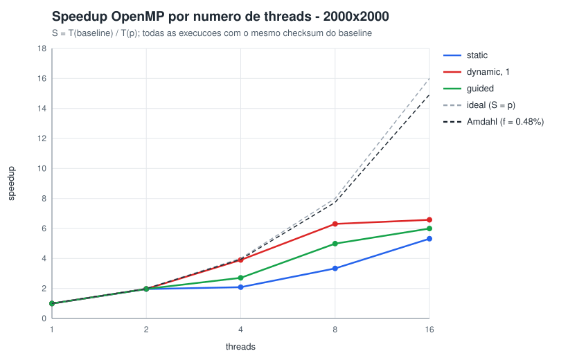
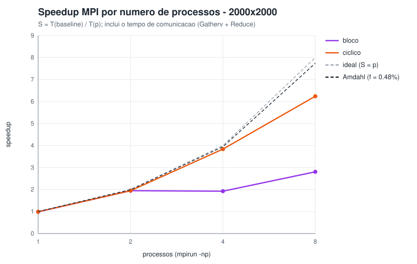
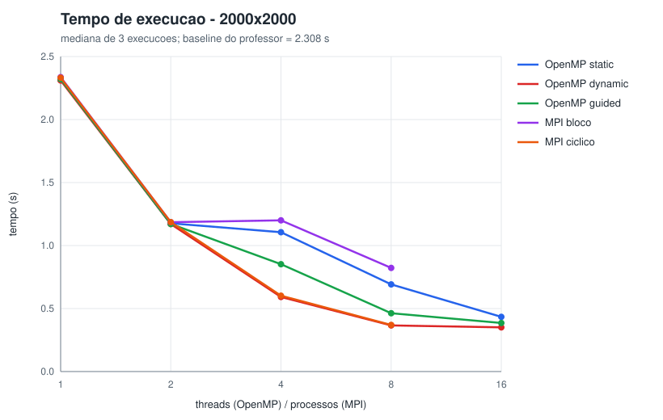
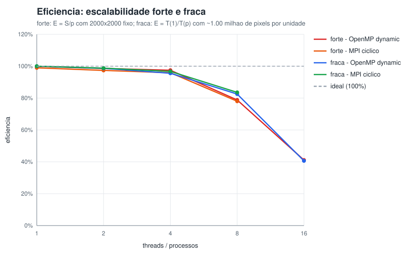
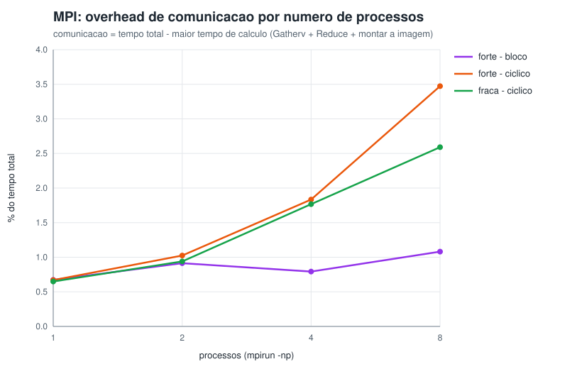

# Conjunto de Mandelbrot em paralelo — OpenMP e MPI

Projeto Acadêmico de **Programação Paralela (CCO085)** — IESB 2026/2 — Prof. Rodrigo Gonçalves.
Problema nº 3 da lista: *Conjunto de Mandelbrot* — desbalanceamento natural de carga, que motiva `schedule(dynamic)`.

O código sequencial do professor (`sequencial/03_mandelbrot.cpp`) é o **gabarito**: ele não foi alterado, e as
versões OpenMP e MPI têm que produzir **exatamente o mesmo checksum** que ele. Quem fez cada parte está em
[`AUTORES.md`](AUTORES.md).

## O que o programa calcula

Cada pixel `(x, y)` vira um número complexo `c = cr + ci·i`, com `cr ∈ [-2,5; 1,0)` e `ci ∈ [-1,25; 1,25)`.
A partir de `z = 0`, repete-se `z = z² + c` até `|z| > 2` (o ponto "escapou") ou até 1000 iterações (o ponto
pertence ao conjunto). O resultado de cada pixel é o número de iterações; o **checksum** é a soma de todos.

- Complexidade: `O(W · H · MAXIT)` no pior caso. Na prática, a média é **177,5 iterações por pixel**
  (17,3% dos pixels chegam a 1000).
- O custo por linha é **muito desigual**: as linhas do meio cortam o conjunto e as das bordas escapam na
  hora. No perfil de 2000×2000, a linha mais cara custa ~520× a mais barata, e as 20% de linhas centrais
  levam ~50% do tempo. É isso que decide quase tudo na paralelização.

## Estrutura do repositório

| Caminho | O que é | Frente |
|---|---|---|
| `sequencial/03_mandelbrot.cpp` | baseline do professor (intocado) | 1 |
| `sequencial/mandelbrot_perfil.cpp` | o mesmo cálculo instrumentado: tempo por trecho, carga por linha, Amdahl | 1 |
| `comum/mandelbrot_comum.hpp` | o cálculo de um pixel, idêntico ao baseline, usado por todas as versões | 1 |
| `openmp/mandelbrot_omp.cpp` | versão OpenMP com `static`, `dynamic` e `guided` | 2 |
| `openmp/corrida_demo.cpp` | condição de corrida no checksum: sem proteção × `critical` × `atomic` × `reduction` | 2 |
| `mpi/mandelbrot_mpi.cpp` | versão MPI com decomposição em bloco × cíclica | 3 |
| `scripts/medir.sh` | gera `resultados/medicoes.csv` (1 aquecimento + 3 medidas, mediana, confere checksum) | — |
| `ferramentas/graficos.cpp` | gera os gráficos SVG e `resultados/resumo.md` a partir do CSV | — |
| `scripts/demo.sh` | roteiro da demonstração ao vivo | — |
| `Dockerfile`, `Makefile` | ambiente igual ao do laboratório e compilação de tudo | — |
| `docs/marco1/` | Marco 1: PDF (análise, perfil, baseline, Amdahl, plano) + fonte HTML e figura | 1 |
| `docs/GUIA_DE_ESTUDO.md` | fundamentos do básico ao avançado e perguntas e respostas para a arguição | — |

## Como rodar do zero

### 1. No laboratório (Linux com g++ e OpenMPI)

```bash
git clone https://github.com/JoaoTroianoSegoria/Projeto-Academico-PP-Mandelbrot.git
cd Projeto-Academico-PP-Mandelbrot
make            # compila as 3 versões, a demo de corrida e a ferramenta de gráficos
make demo       # roteiro da apresentação (ENTER entre as frentes)
```

### 2. Em casa, com Docker (Windows, Linux ou Mac)

Pré-requisito: [Docker Desktop](https://www.docker.com/products/docker-desktop/) instalado e aberto.

```bash
# dentro da pasta do projeto
docker build -t mandelbrot-pp .                                   # monta a imagem (só na 1ª vez)
docker run --rm -it --shm-size=1g -v "${PWD}:/projeto" mandelbrot-pp
# agora você está dentro do container, na pasta /projeto:
make && make demo
```

No Windows use o **PowerShell** (o `${PWD}` funciona lá). A pasta do projeto é "espelhada" dentro do container:
o que o `make medir` gerar aparece na sua pasta do Windows, pronto para o `git commit`.

### 3. No notebook da apresentação (Linux com podman e a imagem da disciplina)

As medições de `resultados/` e os gráficos foram feitos assim, no notebook usado na demonstração. O podman roda
contêineres como o Docker (os comandos são os mesmos); `iesb/pp-lab:2026.2` é a imagem construída a partir do
ambiente oficial da disciplina (`ambiente_pp`, com `podman compose build`).

```bash
cd Projeto-Academico-PP-Mandelbrot
podman run --rm -it --shm-size=1g -v "$PWD:/projeto:Z" -w /projeto localhost/iesb/pp-lab:2026.2
# dentro do container:
make && make demo
```

### 4. Comandos individuais

```bash
./bin/mandelbrot_seq 2000 2000                    # baseline do professor (gabarito)
./bin/mandelbrot_perfil 2000 2000                 # perfil + Amdahl
./bin/corrida_demo 1000 1000 8                    # condição de corrida com 8 threads
./bin/mandelbrot_omp 2000 2000                    # tabela 1-16 threads x static/dynamic/guided
./bin/mandelbrot_omp 2000 2000 8 dynamic          # uma execução
mpirun -np 4 ./bin/mandelbrot_mpi 2000 2000       # sequencial x bloco x cíclico
mpirun -np 4 ./bin/mandelbrot_mpi 2000 2000 ciclico
make medir && make graficos                       # medições (alguns minutos) e gráficos
```

`make medir` aceita variáveis: `THREADS="1 2 4 8" PROCESSOS="1 2 4" make medir`.

## Protocolo de medição

- **Tempo medido**: só o cálculo dos pixels, igual ao baseline (relógio monotônico). No MPI, é o tempo do
  rank mais lento **incluindo a comunicação** (Gatherv + Reduce), porque sem ela o resultado não existe.
- **Repetições**: 1 execução de aquecimento descartada + 3 medidas; usamos a **mediana**.
- **Corretude**: toda execução tem o checksum comparado com o do baseline do mesmo tamanho (coluna `ok` do
  CSV). No modo demonstração, o OpenMP compara também a imagem **pixel a pixel**.
- **Escalabilidade forte**: imagem fixa 2000×2000; threads 1, 2, 4, 8, 16 e processos 1, 2, 4, 8.
- **Escalabilidade fraca**: ~1 milhão de pixels por thread/processo — lado = 1000·√p
  (p = 4 → 2000×2000). Ideal: o tempo não muda.
- **Máquina**: registrada em `resultados/maquina.txt` a cada medição. Os números deste README são do
  **notebook da apresentação**: Intel Core i5-9300H, **4 núcleos físicos e 8 lógicos** (hyper-threading),
  16 GB de RAM, medido dentro do contêiner da disciplina (`iesb/pp-lab:2026.2`, g++ 13.3, Open MPI 4.1.6),
  na tomada. Com 16 threads há **mais threads que núcleos lógicos** (*oversubscription*): está na tabela de
  propósito, para mostrar a curva saturando.
- **Comunicação (MPI)**: `comunicacao = tempo total − maior tempo de cálculo` (as mensagens do `Gatherv` e do
  `Reduce` e a montagem da imagem no rank 0). O `scripts/medir.sh` grava a mediana na coluna `comunicacao_s`.

## Resultados

Os números da última medição estão em [`resultados/resumo.md`](resultados/resumo.md) (gerado
automaticamente) e os dados brutos em [`resultados/medicoes.csv`](resultados/medicoes.csv).

| Speedup OpenMP | Speedup MPI |
|---|---|
|  |  |

| Tempo (escalabilidade forte) | Eficiência (forte e fraca) |
|---|---|
|  |  |

| Overhead de comunicação do MPI |
|---|
|  |

## Decisões de implementação (Frente 2 — OpenMP)

**Padrão: laço paralelo sobre as linhas.** Cada linha é independente (nenhum pixel depende de outro), então
`#pragma omp parallel for` no laço de `y` basta. Tasks e seções não ajudariam: não há divisão e conquista nem
blocos de código diferentes.

**Condições de corrida.**
1. *A imagem*: cada linha é escrita por uma única thread → não há corrida, não precisa de proteção.
2. *O checksum*: todas as threads somariam na mesma variável → **há corrida**. O `corrida_demo` mostra a soma
   sem proteção perdendo dezenas de milhões de iterações (e um valor diferente a cada execução).
   Escolhemos **`reduction(+:soma)`**:

| opção | correta? | custo | por que (não) escolhemos |
|---|---|---|---|
| sem proteção | **não** | — | ler-somar-escrever não é atômico |
| `critical` | sim | o maior: uma tranca por pixel, as threads fazem fila | serve para blocos de código; aqui é exagero |
| `atomic` | sim | médio: instrução atômica da CPU, mas todas disputam a mesma linha de cache | só para uma operação simples |
| `reduction` | sim | o menor: cópia privada por thread, junta só no fim (p somas em vez de W·H) | **escolhida** |

**Escalonamento.** `schedule(dynamic, 1)`: uma linha por vez, quem termina pega a próxima. O custo de pegar
uma linha da fila (uma operação atômica) é desprezível perto do custo de uma linha (~1,15 ms em média). `static`
divide em blocos fixos e sofre exatamente o desbalanceamento previsto no perfil; `guided` fica no meio.

> **Pegadinha:** com **2 threads** o `static` é quase tão bom quanto o `dynamic`. A imagem é simétrica em
> relação ao eixo real (`ci` vai de -1,25 a +1,25), então as duas metades custam o mesmo. Com 4 threads, as
> duas do meio ficam com quase todo o trabalho — o perfil prevê speedup máximo de 2,1 com blocos de 4.

## Discussão: por que o speedup real fica abaixo de Amdahl

O perfil mede a fração serial `f ≈ 0,48%` (alocar e zerar o vetor, somar e imprimir), o que daria
`S(4) ≈ 3,9`, `S(8) ≈ 7,7` e `S_max = 1/f ≈ 209`. Amdahl só enxerga a parte serial; o afastamento real vem de:

1. **Desbalanceamento de carga** — a causa nº 1 neste problema. Com divisão estática, o tempo paralelo é o do
   pedaço mais caro. O perfil prevê o teto em blocos (2 → 2,00; 4 → 2,12; 8 → 3,41; 16 → 6,17), e as curvas de
   `static` e de MPI `bloco` seguem esse teto, não Amdahl: medimos `static` 2,09 / 3,34 com 4 / 8 threads e
   `bloco` 1,92 / 2,81 com 4 / 8 processos — Amdahl prometia 3,9 / 7,7. `dynamic` (3,90 com 4) e MPI `ciclico`
   (3,84 com 4) resolvem distribuindo as linhas caras entre todos. A coluna *desbalanceamento* (maior tempo ÷
   tempo médio) mostra isso diretamente: ~1,9 no `static`/`bloco` com 4, ~1,00 no `dynamic`/`ciclico`.
2. **Overhead de comunicação (MPI)** — no fim, o rank 0 recebe a imagem inteira (`W·H` valores `long`:
   32 MB em 2000×2000) via `MPI_Gatherv` e reorganiza as linhas. Esse custo **não diminui com mais processos**
   (fica em ~9 a 16 ms em 2000×2000), enquanto o cálculo diminui; então a **fração** do tempo gasta em
   comunicação cresce: no `ciclico`, 0,7% com 1 processo, 1,8% com 4 e 3,5% com 8 (tabela em
   `resultados/resumo.md` e gráfico `graficos/comunicacao_mpi.svg`). No `bloco` a fração é menor (~1%) só
   porque o tempo total é maior (dominado pelo bloco mais caro). Na escalabilidade fraca a imagem cresce com p,
   então a comunicação cresce em valor absoluto: 3,8 ms com 1 processo → 18 ms com 8. O OpenMP não tem esse
   custo: as threads escrevem direto no mesmo vetor, ninguém copia nada.
3. **Núcleos lógicos × físicos (SMT / hyper-threading)** — o notebook tem **4 núcleos físicos e 8 lógicos**.
   Até 4 threads, o `dynamic` fica perto do ideal (3,90 com 4, eficiência 97,5%). De 4 para 8 o speedup ainda
   sobe, mas só para 6,30 (eficiência 79%): as threads 5 a 8 não ganham núcleos novos, dividem um núcleo físico
   com outra thread. Elas ajudam porque o laço do Mandelbrot é uma **cadeia de dependências** (cada iteração
   precisa do `zr`/`zi` da anterior): uma thread sozinha deixa as unidades de ponto flutuante esperando o
   resultado anterior, e a segunda thread do núcleo usa esses intervalos. É um ganho parcial (~60%), nunca um
   núcleo inteiro. O MPI `ciclico` mostra o mesmo (3,84 com 4 → 6,24 com 8).
4. **Oversubscription (16 threads em 8 núcleos lógicos)** — de 8 para 16 threads o `dynamic` quase não ganha
   (6,30 → 6,58): não existe hardware para rodar 16 fluxos ao mesmo tempo, o sistema operacional reveza as
   threads. O `static` e o `guided` ainda sobem um pouco (3,34 → 5,32) porque, com blocos menores, cada thread
   pega um pedaço mais misturado de linhas caras e baratas — o revezamento disfarça parte do desbalanceamento,
   mas continua abaixo do `dynamic`.
5. **Turbo e temperatura** — num notebook a frequência do processador depende de quantos núcleos estão
   trabalhando e da temperatura: com 1 núcleo ativo ele acelera mais (turbo) do que com todos ativos. Isso
   reduz um pouco a eficiência com muitas threads. Por isso medimos na tomada, com 1 aquecimento descartado e
   mediana de 3; e por isso, na demonstração do MPI, os ranks ociosos esperam **dormindo** (`MPI_Ibarrier` +
   `usleep`) enquanto o rank 0 mede o sequencial — com `MPI_Barrier` eles ficavam em espera ativa, aqueciam a
   CPU e o sequencial ficava ~12% mais lento, inflando o speedup (aparecia eficiência acima de 100%).
6. **Overhead de criar e sincronizar threads** — criar a equipe, a fila do `dynamic` e a barreira final. Em
   imagens pequenas isso pesa; em 2000×2000 é desprezível.
7. **False sharing** — praticamente **não acontece** aqui, e isso é uma escolha de projeto: cada thread
   escreve linhas inteiras (2000 × 8 bytes = 16 KB, ~250 linhas de cache). Duas threads só compartilham a
   linha de cache na fronteira entre duas linhas da imagem, uma vez por linha. Se dividíssemos por **pixel**
   (`collapse(2)` com pedaços pequenos), threads vizinhas escreveriam na mesma linha de cache o tempo todo.
8. **Banda de memória** — também **não é o gargalo**: cada pixel faz em média 177 iterações só com
   registradores e escreve 8 bytes no fim. O problema é limitado por CPU (*compute-bound*), ao contrário da
   multiplicação de matrizes, por exemplo. Por isso o speedup acompanha o número de núcleos, e o tamanho do
   cache (8 MB de L3 no notebook) não faz diferença aqui.

**Escalabilidade forte × fraca.** Na forte, o trabalho por unidade diminui e os overheads fixos pesam cada vez
mais. Na fraca, o trabalho por unidade é constante; a eficiência cai só pelo que cresce com p: eficiência ~96%
até 4 (núcleos físicos), ~83% com 8 (hyper-threading, OpenMP e MPI iguais) e 41% com 16 threads
(oversubscription: 16 milhões de pixels para 8 núcleos lógicos). No MPI soma-se a comunicação, que cresce com
a imagem.

## Validação de corretude

- `make medir` termina com `OK: todas as execucoes produziram o MESMO checksum do baseline` (ou falha).
- `./bin/mandelbrot_omp 2000 2000` compara imagem e checksum de cada execução com o sequencial (coluna
  `resultado`).
- `mpirun -np N ./bin/mandelbrot_mpi 2000 2000` compara as duas decomposições com o sequencial e confere se a
  imagem montada no rank 0 soma o mesmo que o `MPI_Reduce`.
- O Makefile usa `-ffp-contract=off` para o compilador não fundir multiplicação e soma (FMA), o que mudaria o
  arredondamento e o checksum.
