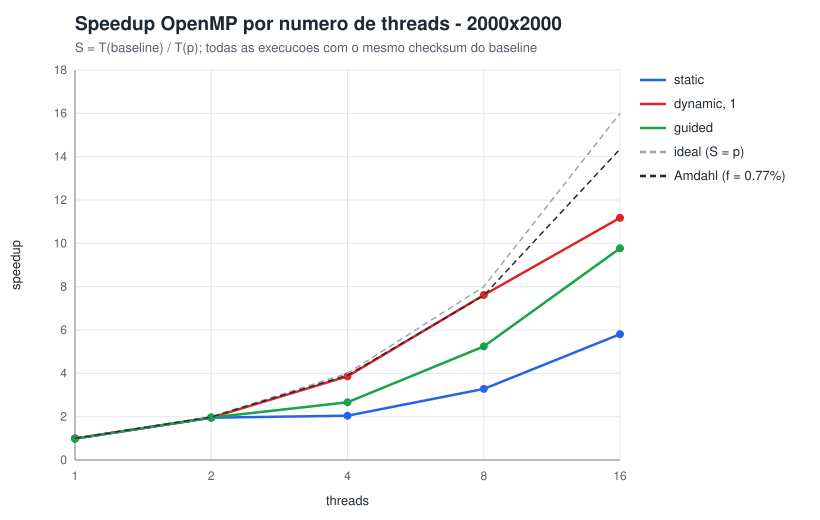
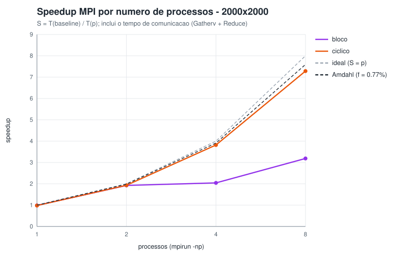
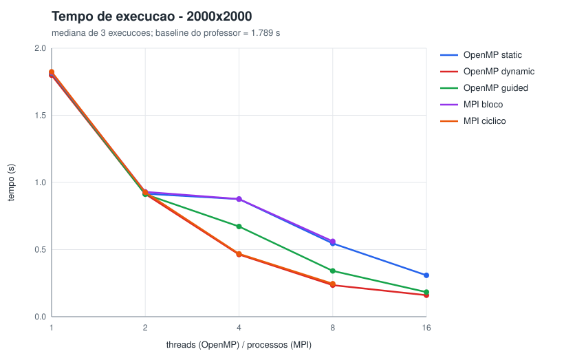
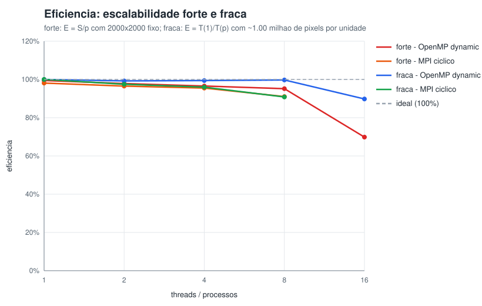

# Conjunto de Mandelbrot em paralelo — OpenMP e MPI

Projeto Acadêmico de **Programação Paralela (CCO085)** — IESB 2026/2 — Prof. Rodrigo Gonçalves.
Problema nº 3 da lista: *Conjunto de Mandelbrot* — desbalanceamento natural de carga, que motiva `schedule(dynamic)`.

O código sequencial do professor (`sequencial/03_mandelbrot.cpp`) é o **gabarito**: ele não foi alterado, e as
versões OpenMP e MPI têm que produzir **exatamente o mesmo checksum** que ele. Quem fez cada parte está em
[`AUTORES.md`](AUTORES.md).

## O que o programa calcula

Cada pixel `(x, y)` vira um número complexo `c = cr + ci·i`, com `cr ∈ [-2,5; 1,0)` e `ci ∈ [-1,25; 1,25)`.
A partir de `z = 0`, repete-se `z = z² + c` até `|z| > 2` (o ponto "escapou") ou até 1000 iterações (o ponto
pertence ao conjunto). O resultado de cada pixel é o número de iterações; o **checksum** é a soma de todos.

- Complexidade: `O(W · H · MAXIT)` no pior caso. Na prática, a média é **177,5 iterações por pixel**
  (17,3% dos pixels chegam a 1000).
- O custo por linha é **muito desigual**: as linhas do meio cortam o conjunto e as das bordas escapam na
  hora. No perfil de 2000×2000, a linha mais cara custa ~1000× a mais barata, e as 20% de linhas centrais
  levam ~49% do tempo. É isso que decide quase tudo na paralelização.

## Estrutura do repositório

| Caminho | O que é | Frente |
|---|---|---|
| `sequencial/03_mandelbrot.cpp` | baseline do professor (intocado) | 1 |
| `sequencial/mandelbrot_perfil.cpp` | o mesmo cálculo instrumentado: tempo por trecho, carga por linha, Amdahl | 1 |
| `comum/mandelbrot_comum.hpp` | o cálculo de um pixel, idêntico ao baseline, usado por todas as versões | 1 |
| `openmp/mandelbrot_omp.cpp` | versão OpenMP com `static`, `dynamic` e `guided` | 2 |
| `openmp/corrida_demo.cpp` | condição de corrida no checksum: sem proteção × `critical` × `atomic` × `reduction` | 2 |
| `mpi/mandelbrot_mpi.cpp` | versão MPI com decomposição em bloco × cíclica | 3 |
| `scripts/medir.sh` | gera `resultados/medicoes.csv` (1 aquecimento + 3 medidas, mediana, confere checksum) | — |
| `ferramentas/graficos.cpp` | gera os gráficos SVG e `resultados/resumo.md` a partir do CSV | — |
| `scripts/demo.sh` | roteiro da demonstração ao vivo | — |
| `Dockerfile`, `Makefile` | ambiente igual ao do laboratório e compilação de tudo | — |

## Como rodar do zero

### 1. No laboratório (Linux com g++ e OpenMPI)

```bash
git clone https://github.com/JoaoTroianoSegoria/Projeto-Academico-PP-Mandelbrot.git
cd Projeto-Academico-PP-Mandelbrot
make            # compila as 3 versões, a demo de corrida e a ferramenta de gráficos
make demo       # roteiro da apresentação (ENTER entre as frentes)
```

### 2. Em casa, com Docker (Windows, Linux ou Mac)

Pré-requisito: [Docker Desktop](https://www.docker.com/products/docker-desktop/) instalado e aberto.

```bash
# dentro da pasta do projeto
docker build -t mandelbrot-pp .                                   # monta a imagem (só na 1ª vez)
docker run --rm -it --shm-size=1g -v "${PWD}:/projeto" mandelbrot-pp
# agora você está dentro do container, na pasta /projeto:
make && make demo
```

No Windows use o **PowerShell** (o `${PWD}` funciona lá). A pasta do projeto é "espelhada" dentro do container:
o que o `make medir` gerar aparece na sua pasta do Windows, pronto para o `git commit`.

### 3. Comandos individuais

```bash
./bin/mandelbrot_seq 2000 2000                    # baseline do professor (gabarito)
./bin/mandelbrot_perfil 2000 2000                 # perfil + Amdahl
./bin/corrida_demo 1000 1000 8                    # condição de corrida com 8 threads
./bin/mandelbrot_omp 2000 2000                    # tabela 1-16 threads x static/dynamic/guided
./bin/mandelbrot_omp 2000 2000 8 dynamic          # uma execução
mpirun -np 4 ./bin/mandelbrot_mpi 2000 2000       # sequencial x bloco x cíclico
mpirun -np 4 ./bin/mandelbrot_mpi 2000 2000 ciclico
make medir && make graficos                       # medições (alguns minutos) e gráficos
```

`make medir` aceita variáveis: `THREADS="1 2 4 8" PROCESSOS="1 2 4" make medir`.

## Protocolo de medição

- **Tempo medido**: só o cálculo dos pixels, igual ao baseline (relógio monotônico). No MPI, é o tempo do
  rank mais lento **incluindo a comunicação** (Gatherv + Reduce), porque sem ela o resultado não existe.
- **Repetições**: 1 execução de aquecimento descartada + 3 medidas; usamos a **mediana**.
- **Corretude**: toda execução tem o checksum comparado com o do baseline do mesmo tamanho (coluna `ok` do
  CSV). No modo demonstração, o OpenMP compara também a imagem **pixel a pixel**.
- **Escalabilidade forte**: imagem fixa 2000×2000; threads 1, 2, 4, 8, 16 e processos 1, 2, 4, 8.
- **Escalabilidade fraca**: ~1 milhão de pixels por thread/processo — lado = 1000·√p
  (p = 4 → 2000×2000). Ideal: o tempo não muda.
- **Máquina**: registrada em `resultados/maquina.txt` a cada medição.

## Resultados

Os números da última medição estão em [`resultados/resumo.md`](resultados/resumo.md) (gerado
automaticamente) e os dados brutos em [`resultados/medicoes.csv`](resultados/medicoes.csv).

| Speedup OpenMP | Speedup MPI |
|---|---|
|  |  |

| Tempo (escalabilidade forte) | Eficiência (forte e fraca) |
|---|---|
|  |  |

## Decisões de implementação (Frente 2 — OpenMP)

**Padrão: laço paralelo sobre as linhas.** Cada linha é independente (nenhum pixel depende de outro), então
`#pragma omp parallel for` no laço de `y` basta. Tasks e seções não ajudariam: não há divisão e conquista nem
blocos de código diferentes.

**Condições de corrida.**
1. *A imagem*: cada linha é escrita por uma única thread → não há corrida, não precisa de proteção.
2. *O checksum*: todas as threads somariam na mesma variável → **há corrida**. O `corrida_demo` mostra a soma
   sem proteção perdendo dezenas de milhões de iterações (e um valor diferente a cada execução).
   Escolhemos **`reduction(+:soma)`**:

| opção | correta? | custo | por que (não) escolhemos |
|---|---|---|---|
| sem proteção | **não** | — | ler-somar-escrever não é atômico |
| `critical` | sim | o maior: uma tranca por pixel, as threads fazem fila | serve para blocos de código; aqui é exagero |
| `atomic` | sim | médio: instrução atômica da CPU, mas todas disputam a mesma linha de cache | só para uma operação simples |
| `reduction` | sim | o menor: cópia privada por thread, junta só no fim (p somas em vez de W·H) | **escolhida** |

**Escalonamento.** `schedule(dynamic, 1)`: uma linha por vez, quem termina pega a próxima. O custo de pegar
uma linha da fila (uma operação atômica) é desprezível perto do custo de uma linha (~1 ms em média). `static`
divide em blocos fixos e sofre exatamente o desbalanceamento previsto no perfil; `guided` fica no meio.

> **Pegadinha:** com **2 threads** o `static` é quase tão bom quanto o `dynamic`. A imagem é simétrica em
> relação ao eixo real (`ci` vai de -1,25 a +1,25), então as duas metades custam o mesmo. Com 4 threads, as
> duas do meio ficam com quase todo o trabalho — o perfil prevê speedup máximo de 2,1 com blocos de 4.

## Discussão: por que o speedup real fica abaixo de Amdahl

O perfil mede a fração serial `f ≈ 0,8%` (alocar e zerar o vetor, somar e imprimir), o que daria
`S(8) ≈ 7,5` e `S_max = 1/f ≈ 120`. Amdahl só enxerga a parte serial; o afastamento real vem de:

1. **Desbalanceamento de carga** — a causa nº 1 neste problema. Com divisão estática, o tempo paralelo é o do
   pedaço mais caro. O perfil prevê o teto em blocos (2 → 1,98; 4 → 2,1; 8 → 3,4; 16 → 6,3), e as curvas de
   `static` e de MPI `bloco` seguem esse teto, não Amdahl. `dynamic` e MPI `ciclico` resolvem distribuindo as
   linhas caras entre todos. A coluna *desbalanceamento* (maior tempo ÷ tempo médio) mostra isso diretamente.
2. **Overhead de comunicação (MPI)** — no fim, o rank 0 recebe a imagem inteira (`W·H` valores `long`:
   32 MB em 2000×2000) via `MPI_Gatherv` e reorganiza as linhas. Esse custo não diminui com mais processos;
   cresce em proporção, então a eficiência do MPI cai mais rápido que a do OpenMP, que não copia nada.
3. **Núcleos lógicos × físicos (hyper-threading)** — `nproc` conta núcleos lógicos. Duas threads no mesmo
   núcleo físico dividem as mesmas unidades de ponto flutuante; como o Mandelbrot é quase só conta, o ganho
   depois do número de núcleos físicos é pequeno. Com mais threads que núcleos lógicos (16 numa máquina de 8),
   a curva satura: só há troca de contexto.
4. **Overhead de criar e sincronizar threads** — criar a equipe, a fila do `dynamic` e a barreira final. Em
   imagens pequenas isso pesa; em 2000×2000 é desprezível.
5. **False sharing** — praticamente **não acontece** aqui, e isso é uma escolha de projeto: cada thread
   escreve linhas inteiras (2000 × 8 bytes = 16 KB, ~250 linhas de cache). Duas threads só compartilham a
   linha de cache na fronteira entre duas linhas da imagem, uma vez por linha. Se dividíssemos por **pixel**
   (`collapse(2)` com pedaços pequenos), threads vizinhas escreveriam na mesma linha de cache o tempo todo.
6. **Banda de memória** — também **não é o gargalo**: cada pixel faz em média 177 iterações só com
   registradores e escreve 8 bytes no fim. O problema é limitado por CPU (*compute-bound*), ao contrário da
   multiplicação de matrizes, por exemplo. Por isso o speedup acompanha o número de núcleos físicos.

**Escalabilidade forte × fraca.** Na forte, o trabalho por unidade diminui e os overheads fixos pesam cada vez
mais. Na fraca, o trabalho por unidade é constante; a eficiência cai só pelo que cresce com p (comunicação
no MPI, disputa por núcleos quando p passa do número de núcleos físicos).

## Validação de corretude

- `make medir` termina com `OK: todas as execucoes produziram o MESMO checksum do baseline` (ou falha).
- `./bin/mandelbrot_omp 2000 2000` compara imagem e checksum de cada execução com o sequencial (coluna
  `resultado`).
- `mpirun -np N ./bin/mandelbrot_mpi 2000 2000` compara as duas decomposições com o sequencial e confere se a
  imagem montada no rank 0 soma o mesmo que o `MPI_Reduce`.
- O Makefile usa `-ffp-contract=off` para o compilador não fundir multiplicação e soma (FMA), o que mudaria o
  arredondamento e o checksum.
